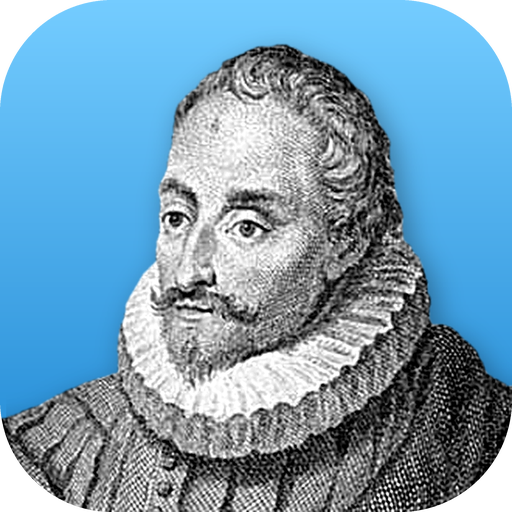

<div align="center">
  <a href="https://getnodalia.com">
    <picture>
      <source media="(prefers-color-scheme: dark)" srcset="https://raw.githubusercontent.com/danielmigueltejedor/nodalia-web/main/assets/brand/nodalia-wordmark-white.svg">
      
    </picture>
  </a>
  <br><br>
  
  <h1>Letra</h1>
  <p><strong>A word processor for the Nodalia suite, built on the WordCraft engine.</strong></p>

  <p>
    
    
    
    
  </p>

  <p>
    <a href="#overview">Overview</a> ·
    <a href="#what-you-get-today">Today</a> ·
    <a href="#build-and-run">Build</a> ·
    <a href="#project-status">Status</a> ·
    <a href="#keeping-up-with-upstream">Upstream</a> ·
    <a href="#the-nodalia-suite">Suite</a> ·
    <a href="#license">License</a>
  </p>
</div>

---

## Overview

**Letra** is the word processor of [Nodalia](https://getnodalia.com). It is built on the engine of
[WordCraft](https://github.com/storytold/wordcraft), which lives in this repository and is kept up to
date with upstream.

> [!IMPORTANT]
> **Letra is at an early stage.** What runs today is the upstream application.
> Nodalia's own interface is not wired in yet and there are no published builds.

## What you get today

- The WordCraft engine.
- The upstream desktop application. Crate and binary names are still upstream's.
- The engine's own feature description, kept as [`docs/upstream-readme.md`](docs/upstream-readme.md).

## Build and run

You need a recent stable Rust toolchain.

```bash
git clone https://github.com/danielmigueltejedor/letra.git
cd letra
cargo run --release -p wordcraft
```

The crate is still called `wordcraft`; it will be renamed with the product.

## Project status

| Area | State |
|---|---|
| Engine | Imported from `storytold/wordcraft` and tracked in [`docs/upstream.md`](docs/upstream.md) |
| Product name | Pending: crates and binary still carry upstream's name (`wordcraft`) |
| App icon | Done: portrait of Miguel de Cervantes |
| Nodalia interface | Not started |
| Shared interface resources | Planned: the Nodalia apps will share interface components and styles |
| Installable packages | None published |

## Keeping up with upstream

[`docs/upstream.md`](docs/upstream.md) records which upstream commit is integrated. Updates are
merges of upstream's `main`, so Letra's own changes are kept and conflicts are resolved in the open.

## App icon

Nodalia app icons are black-and-white portraits of historical figures over the app colour.
Letra's is Miguel de Cervantes, the foremost writer in Spanish. Provenance and licence are in [`assets/app-icon/`](assets/app-icon/).

## The Nodalia suite

Letra is one of the applications of [Nodalia](https://getnodalia.com), an independent software
project developed in public by [Daniel Miguel Tejedor](https://danielmigueltejedor.com).

## License

`MIT OR Apache-2.0`, as upstream. The licence files and `NOTICE` of WordCraft are kept.
See [`LICENSE-MIT`](LICENSE-MIT) and [`LICENSE-APACHE`](LICENSE-APACHE).

## Credits

Letra would not exist without [WordCraft](https://github.com/storytold/wordcraft) and its contributors.
